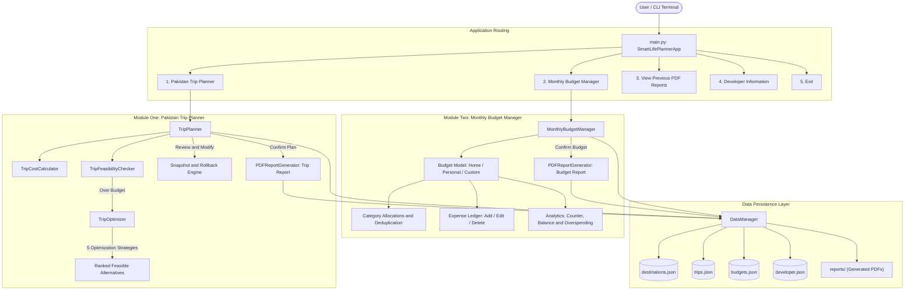
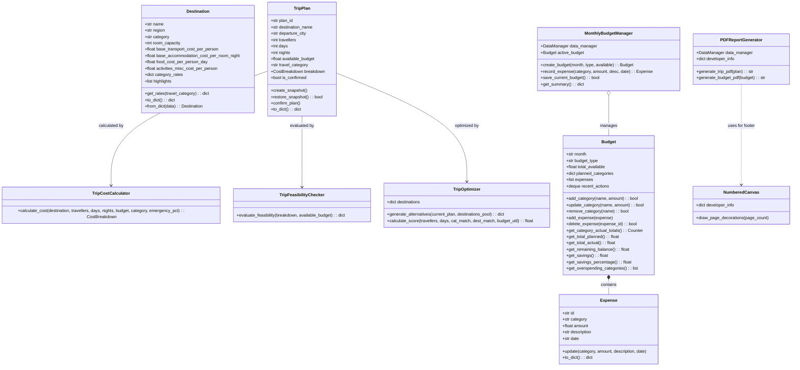

<p align="center">
  
</p>

<p align="center">
  <a href="https://raw.githack.com/muhammadaliajaz/python-smart-life-planner/main/preview.html"><b>👉 Click Here to Launch Live Interactive Dashboard</b></a>
</p>

<p align="center">
  
  
  
  
</p>

---

## Developer Profile
- **Author:** Muhammad Ali Ajaz
- **GitHub:** [@muhammadaliajaz](https://github.com/muhammadaliajaz)
- **Email:** [chaudharyaliajaz@gmail.com](mailto:chaudharyaliajaz@gmail.com)
- **Repository:** `python-smart-life-planner`

---

## 1. Project Overview

**Smart Life Planner** is a comprehensive Python application developed to tackle two core planning and financial challenges:

1. **Pakistan Trip Planner:** Plans domestic trips across 9 prominent destinations in Pakistan (Murree, Nathiagali, Swat, Kalam, Hunza, Skardu, Naran, Lahore, Islamabad). It calculates deterministic itemized costs, room requirements using ceiling division, duration (days and separate 0-night day trips), and emergency reserves. When an itinerary exceeds the available budget, an intelligent optimization engine computes 5 distinct feasible alternatives (increasing budget, reducing travellers, shortening duration, switching travel tiers, or recommending affordable alternative destinations) without hardcoding.
2. **Monthly Budget Manager:** Manages household (`Home & Kitchen`) and personal (`Personal Finance`) budgets, tracks planned allocations against actual expenditures, highlights category-specific and overall overspending, and calculates net savings and savings rates.

Both modules feature state rollback protection, atomic JSON persistence, 73 automated unit tests, and publication-quality PDF report generation using ReportLab.

---

## 2. Interactive HTML Web Preview

An interactive HTML dashboard is included for live exploration, testing, and evaluation:

- 🌐 **[Live Online Preview (Instant in Browser)](https://raw.githack.com/muhammadaliajaz/python-smart-life-planner/main/preview.html)**
- 📁 **Local File:** Double-click `preview.html` or `index.html` in your local project folder to open in Chrome/Edge/Firefox.

### Interactive Features Included:
1. **Pakistan Trip Planner:** Test live costing by changing destination, budget, travellers, duration (days/nights), and tier. View live feasibility badges, day-wise itineraries, and real-time optimization alternatives when over budget.
2. **Monthly Budget Manager:** Adjust monthly income, switch budget types, add expenses in real time, view remaining balance, and see overspending alerts.
3. **PDF Report Specimen:** Visual representation of the ReportLab generated multi-page PDF layout with developer credentials in the footer and direct download/print support.

---

## 3. System Architecture & Diagrams

### 3.1 High-Level Architecture Flowchart



---

### 3.2 OOP Class Diagram



---

### 3.3 Trip Optimization Decision Flowchart


---

## 4. Mathematical Calculations & Formulas

### Module One: Pakistan Trip Planner
$$\text{Transportation Cost} = \text{cost per person} \times \text{travellers}$$
$$\text{Required Rooms} = \left\lceil \frac{\text{travellers}}{\text{room capacity}} \right\rceil$$
$$\text{Accommodation Cost} = \text{room rate} \times \text{required rooms} \times \text{nights} \quad (\text{0 if nights} = 0)$$
$$\text{Food Cost} = \text{daily food cost per person} \times \text{travellers} \times \text{days}$$
$$\text{Activities and Misc} = \text{activity rate per person} \times \text{travellers}$$
$$\text{Subtotal} = \text{Transportation} + \text{Accommodation} + \text{Food} + \text{Activities}$$
$$\text{Emergency Allowance} = \text{Subtotal} \times \left(\frac{\text{emergency percentage}}{100}\right)$$
$$\text{Total Trip Cost} = \text{Subtotal} + \text{Emergency Allowance}$$
$$\text{Cost Per Person} = \frac{\text{Total Trip Cost}}{\text{travellers}}$$

### Module Two: Monthly Budget Manager
$$\text{Total Planned} = \sum_{i=1}^{n} \text{Planned Amount}_i$$
$$\text{Total Actual} = \sum_{j=1}^{m} \text{Expense Amount}_j$$
$$\text{Remaining Balance} = \text{Total Available Income} - \text{Total Actual}$$
$$\text{Net Savings} = \max(0, \text{Remaining Balance})$$
$$\text{Savings Percentage} = \left(\frac{\text{Net Savings}}{\text{Total Available Income}}\right) \times 100$$
$$\text{Category Difference}_i = \text{Planned Amount}_i - \text{Actual Amount}_i$$
$$\text{Category Overspent if } \text{Actual Amount}_i > \text{Planned Amount}_i$$

---

## 5. Python Standard Library Collections Usage

The project utilizes **four distinct data structures** from Python's standard `collections` module:

| Collection Structure | Project Implementation File | Purpose & Architectural Justification |
|---|---|---|
| `collections.namedtuple` | `models/trip.py`, `utils/validators.py`, `services/trip_optimizer.py` | Defines lightweight, immutable structured records for `CostBreakdown`, `OptimizationOption`, and `ValidationResult`. |
| `collections.Counter` | `models/budget.py` (`Budget.get_category_actual_totals`) | Aggregates recorded expenses into category-wise totals in $O(N)$ time with arithmetic grouping. |
| `collections.defaultdict` | `services/trip_planner.py` (`TripPlanner.destinations_by_type`) | Groups destination objects by regional category (`Mountains`, `Lakes & Nature`, `Historical Places`) without key initialization boilerplate. |
| `collections.deque` | `models/budget.py`, `services/trip_planner.py`, `utils/data_manager.py` | Implements bounded ring buffers (`maxlen=40`/`50`) tracking audit logs and state changes. |

---

## 6. Comprehensive Testing Use Cases & Verification Matrix

The test suite consists of **73 automated unit tests** covering normal execution, financial boundaries, input validation, corrupted file recovery, dynamic adjustments, and PDF generation. All tests are mapped directly to formal software engineering **Use Cases (UC)**.

### Execution Command
```bash
python -m pytest -v
```

---

### 6.1 Category 1: Pakistan Trip Planning & Cost Engine (`UC-TRIP`)

| Use Case ID | Use Case / Objective | Test Scenario & Input Conditions | Expected System Behavior | Pytest Method | Status |
|:---:|---|---|---|---|:---:|
| **UC-TRIP-01** | Room Capacity Ceiling Math | 1, 2, 3, and 5 travellers with capacity = 2 | Solves $\lceil \text{travellers} / 2 \rceil \to$ 1, 1, 2, 3 rooms | `test_room_calculation` | **PASSED** |
| **UC-TRIP-02** | Zero-Night Day Trip Costing | 1 Day / 0 Nights duration input | Lodging cost strictly PKR 0.00; transport + food calculated | `test_zero_night_trip_has_zero_accommodation` | **PASSED** |
| **UC-TRIP-03** | Multi-Tier Cost Breakdown | Hunza, 3 Travellers, 4 Days, 3 Nights (Standard tier) | Computes itemized transport, food, stay, 10% emergency reserve | `test_cost_components_accuracy` | **PASSED** |
| **UC-TRIP-04** | Exact & Boundary Financial Limits | Total cost equals budget, +1 PKR above, -1 PKR below | Correctly flags: "Exactly On Budget", "Within Budget", "Over Budget" | `test_budget_boundaries` | **PASSED** |
| **UC-TRIP-05** | Destination Catalog Filtering | Filter catalog by `Mountains`, `Lakes & Nature`, `Historical Places` | Matches exact categorized subsets from `destinations.json` | `test_destination_filtering` | **PASSED** |
| **UC-TRIP-06** | Day-Wise Itinerary Generation | Multi-day trip vs 1-Day zero-night trip | Generates day-by-day travel, sightseeing, activity and return schedule | `test_create_trip_plan`, `test_itinerary_day_trip` | **PASSED** |
| **UC-TRIP-07** | State Snapshot & Rollback Safety | Modify travellers/tier, review changes, then cancel | Restores prior confirmed snapshot cleanly without overwriting state | `test_dynamic_modification_cancellation` | **PASSED** |
| **UC-TRIP-08** | Trip Finalization & Persistence | Confirm final plan and save | Sets `is_confirmed=True`, persists atomic record to `trips.json` | `test_confirm_and_save_plan` | **PASSED** |

---

### 6.2 Category 2: Intelligent Feasibility & Optimization Engine (`UC-OPT`)

| Use Case ID | Use Case / Objective | Test Scenario & Input Conditions | Expected System Behavior | Pytest Method | Status |
|:---:|---|---|---|---|:---:|
| **UC-OPT-01** | Within-Budget Surplus Calculation | Estimated cost < Available budget | `is_feasible = True`, calculates remaining surplus PKR | `test_within_budget_evaluation` | **PASSED** |
| **UC-OPT-02** | Over-Budget Shortage Detection | Estimated cost > Available budget | `is_feasible = False`, calculates exact deficit and shortage % | `test_over_budget_evaluation` | **PASSED** |
| **UC-OPT-03** | 5-Strategy Auto-Optimization | Trip exceeding available budget by PKR 70,000 | Recalculates 5 feasible options (Budget, Travellers, Days, Dest, Tier) | `test_over_budget_generates_comprehensive_alternatives` | **PASSED** |
| **UC-OPT-04** | Strict Feasibility Verification Guard | Recalculated alternative candidates | Never hardcodes; strictly verifies recalculated total $\le$ budget | `test_reduction_strategies_when_feasible` | **PASSED** |
| **UC-OPT-05** | Extreme Budget Infeasibility Guard | Unrealistically low budget (e.g. PKR 500) | Safely handles without crash; marks 0 alternatives as feasible | `test_extreme_budget_insufficient_for_any_destination` | **PASSED** |

---

### 6.3 Category 3: Monthly Budget Manager & Ledger (`UC-BUD`)

| Use Case ID | Use Case / Objective | Test Scenario & Input Conditions | Expected System Behavior | Pytest Method | Status |
|:---:|---|---|---|---|:---:|
| **UC-BUD-01** | Monthly Budget Provisioning | Initialize budget for "Home & Kitchen" / "Personal Finance" | Sets monthly income, binds pre-populated categories | `test_create_budget_valid` | **PASSED** |
| **UC-BUD-02** | Category Lifecycle & Duplicate Guard | Add custom category, check duplicate, edit, remove | Updates planned ledger; rejects case-insensitive duplicate names | `test_category_management` | **PASSED** |
| **UC-BUD-03** | Expense Ledger CRUD Operations | Record expense, update amount/description, delete by ID | Mutates expense list; handles non-existent IDs gracefully | `test_record_update_delete_expense` | **PASSED** |
| **UC-BUD-04** | Real-Time Overspending Detection | Expense in a category exceeds planned allocation | Uses `Counter` to aggregate actuals and flags overspent categories | `test_budget_calculations_and_overspending` | **PASSED** |
| **UC-BUD-05** | Financial Health & Savings Analysis | Total actual spending vs available monthly income | Computes net savings, balance, and savings percentage | `test_budget_calculations_and_overspending` | **PASSED** |
| **UC-BUD-06** | Budget State Reloading | Save budget and reload via clean manager instance | Matches stored income, planned categories, and expense items | `test_save_and_load_budget` | **PASSED** |

---

### 6.4 Category 4: Data Persistence, Error Recovery & Audit Logging (`UC-DATA`)

| Use Case ID | Use Case / Objective | Test Scenario & Input Conditions | Expected System Behavior | Pytest Method | Status |
|:---:|---|---|---|---|:---:|
| **UC-DATA-01** | Missing Directory Auto-Provisioning | Application launch with missing folders | Provisions `data/`, `config/`, and `reports/` automatically | `test_directory_creation` | **PASSED** |
| **UC-DATA-02** | Developer Profile Loading & Fallback | Missing or default `developer.json` | Reads developer metadata; falls back to defaults safely | `test_developer_config_defaults`, `test_save_and_load_developer_config` | **PASSED** |
| **UC-DATA-03** | Corrupted JSON Graceful Recovery | JSON file contains truncated or malformed syntax | Recovers gracefully, logs warning, returns empty structure (no crash) | `test_corrupted_json_handling` | **PASSED** |
| **UC-DATA-04** | Zero-Byte Empty JSON Handling | 0-byte blank file encountered | Safely loads without JSONDecodeError, initializes defaults | `test_empty_json_handling` | **PASSED** |
| **UC-DATA-05** | Audit Logging Ring Buffers | User actions, modifications, and rollbacks | Tracks bounded operational history using `collections.deque` | `test_budget_manager.py`, `test_data_manager.py` | **PASSED** |

---

### 6.5 Category 5: ReportLab Multi-Page PDF Generation (`UC-PDF`)

| Use Case ID | Use Case / Objective | Test Scenario & Input Conditions | Expected System Behavior | Pytest Method | Status |
|:---:|---|---|---|---|:---:|
| **UC-PDF-01** | Unconfirmed Plan PDF Rejection | Attempt to generate PDF report for draft unconfirmed plan | Enforces business rule: raises `ValueError` before confirmation | `test_unconfirmed_trip_rejects_pdf_generation` | **PASSED** |
| **UC-PDF-02** | Confirmed Trip Multi-Page PDF | Confirmed plan with itemized breakdown & itinerary | Generates valid, non-empty multi-page ReportLab PDF | `test_confirmed_trip_generates_pdf` | **PASSED** |
| **UC-PDF-03** | Monthly Financial Report PDF | Active monthly budget with planned & actual expenses | Generates publication-ready PDF with financial tables & metrics | `test_monthly_budget_generates_pdf` | **PASSED** |
| **UC-PDF-04** | Dynamic Page Decorators & Numbering | Multi-page document generation via `NumberedCanvas` | Draws developer metadata, GitHub, email, and "Page X of Y" footer | `test_pdf_generator.py` | **PASSED** |
| **UC-PDF-05** | Collision-Proof Unique File Naming | Two consecutive PDF exports for the same plan | Generates distinct timestamped filenames (`TRIP_...`, `BUD_...`) | `test_unique_pdf_filenames_prevent_overwriting` | **PASSED** |

---

### 6.6 Category 6: Input Validation & Security Boundary Constraints (`UC-VAL`)

| Use Case ID | Use Case / Objective | Test Scenario & Input Conditions | Expected System Behavior | Pytest Method | Status |
|:---:|---|---|---|---|:---:|
| **UC-VAL-01** | Positive Number Validation [11 tests] | Zero, negative values, alphabetic strings, None, positive floats | Rejects $\le 0$ and non-numeric inputs with clear user error messages | `test_validate_positive_number_valid`, `test_validate_positive_number_invalid` | **PASSED** |
| **UC-VAL-02** | Integer Range Constraints [10 tests] | Out-of-bounds travellers (>50), non-integers, floats | Enforces $[1, 50]$ traveller constraints strictly | `test_validate_integer_range_valid`, `test_validate_integer_range_invalid` | **PASSED** |
| **UC-VAL-03** | Duration Logical Rules [5 tests] | Nights > Days, negative nights, 0 days, equal days/nights | Enforces: Days $\ge 1$, Nights $\ge 0$, Nights $\le$ Days | `test_validate_trip_duration_valid`, `test_validate_trip_duration_invalid` | **PASSED** |
| **UC-VAL-04** | Travel Tier & Destination Normalization [10 tests] | "budget", "STANDARD", "PREMIUM", invalid "UltraLuxury" | Title-cases valid categories; rejects invalid categories safely | `test_validate_travel_category_valid`, `test_validate_destination_type_valid` | **PASSED** |
| **UC-VAL-05** | RFC Email & String Sanitization [7 tests] | Malformed emails ("user@", "user@.com"), empty strings | Validates regex email format; strips and validates non-empty text | `test_validate_email`, `test_validate_non_empty_string` | **PASSED** |

---

### 6.7 Automated Test Execution Output
```text
============================= test session starts =============================
platform win32 -- Python 3.14.5, pytest-9.2.0, pluggy-1.7.0
rootdir: C:\Users\aliaj\Documents\PSEB-Bootcamp\Curriculum\Week-01_Python-Basics\Python-Final-Project-Assessment
plugins: anyio-4.15.1
collected 73 items

tests/test_budget_manager.py ......                                      [  8%]
tests/test_data_manager.py .......                                       [ 17%]
tests/test_feasibility_checker.py ..                                     [ 20%]
tests/test_pdf_generator.py ....                                         [ 26%]
tests/test_trip_calculator.py .....                                      [ 32%]
tests/test_trip_optimizer.py ...                                         [ 36%]
tests/test_trip_planner.py ......                                        [ 45%]
tests/test_validators.py ........................................        [100%]

============================= 73 passed in 0.77s ==============================
```

---

## 7. Destination Catalog & Cost Assumptions

The catalog is stored in `data/destinations.json`. Costs reflect regional planning estimates:

| Destination | Region | Category | Room Cap | Base Transport | Base Room / Night | Food / Day | Activities / Person | Highlights |
|---|---|---|---|---|---|---|---|---|
| **Murree** | Punjab | Mountains | 2 | PKR 3,000 | PKR 4,500 | PKR 2,000 | PKR 2,500 | Mall Road, Patriata Cable Car, Pindi Point |
| **Nathiagali** | KP | Mountains | 2 | PKR 3,500 | PKR 5,000 | PKR 2,200 | PKR 2,500 | Mukshpuri Trek, Miranjani Peak, Pipeline Track |
| **Swat** | KP | Lakes & Nature | 2 | PKR 5,000 | PKR 4,500 | PKR 2,200 | PKR 3,000 | Malam Jabba, White Palace Marghazar |
| **Kalam** | KP | Lakes & Nature | 2 | PKR 6,500 | PKR 5,000 | PKR 2,400 | PKR 3,500 | Mahodand Lake Jeep Safari, Ushu Forest |
| **Hunza** | Gilgit-Baltistan | Mountains | 2 | PKR 12,000 | PKR 6,500 | PKR 2,800 | PKR 4,500 | Baltit Fort, Attabad Lake, Passu Cones |
| **Skardu** | Gilgit-Baltistan | Lakes & Nature | 2 | PKR 14,000 | PKR 7,000 | PKR 3,000 | PKR 5,000 | Shangrila Lake, Cold Desert, Deosai Plains |
| **Naran** | KP | Lakes & Nature | 2 | PKR 6,000 | PKR 5,000 | PKR 2,400 | PKR 3,500 | Lake Saiful Muluk, Babusar Top, Kunhar River |
| **Lahore** | Punjab | Historical Places | 2 | PKR 3,500 | PKR 4,000 | PKR 2,500 | PKR 2,000 | Badshahi Mosque, Lahore Fort, Walled City |
| **Islamabad** | Federal Capital | Historical Places | 2 | PKR 3,000 | PKR 4,500 | PKR 2,500 | PKR 2,200 | Faisal Mosque, Daman-e-Koh, Lok Virsa |

---

## 8. Installation & Execution Guide

### 8.1 Clone & Setup
```bash
git clone https://github.com/muhammadaliajaz/python-smart-life-planner.git
cd python-smart-life-planner
pip install -r requirements.txt
```

### 8.2 Run the Application
```bash
python main.py
```

### 8.3 Run Automated Tests
```bash
python -m pytest -v
```

---

## 9. Developer Configuration & PDF Reports

Developer metadata is stored in `config/developer.json`:
```json
{
  "developer_name": "Muhammad Ali Ajaz",
  "github_username": "muhammadaliajaz",
  "email": "chaudharyaliajaz@gmail.com"
}
```

This configuration is automatically loaded and displayed in:
1. The **Developer Information** menu option in `main.py`.
2. The bottom **footer line** on every page of generated PDF reports via `NumberedCanvas`:
   ```text
   Smart Life Planner | Developer: Muhammad Ali Ajaz | GitHub: @muhammadaliajaz | Email: chaudharyaliajaz@gmail.com | Page X of Y
   ```
