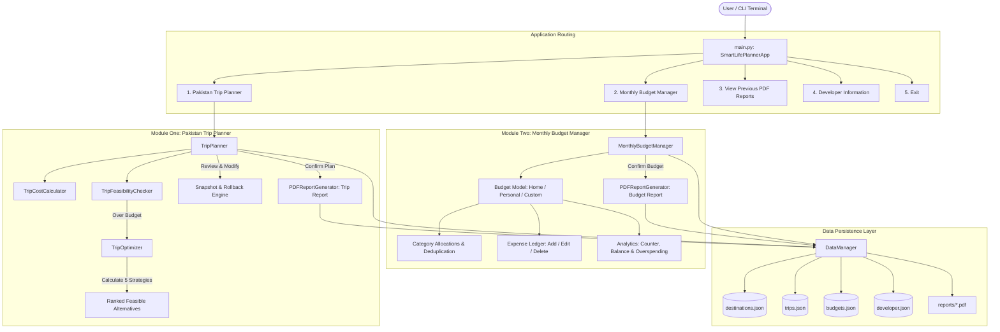
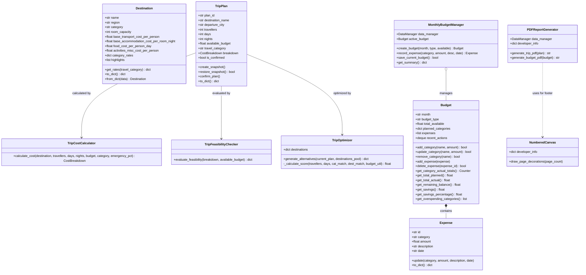
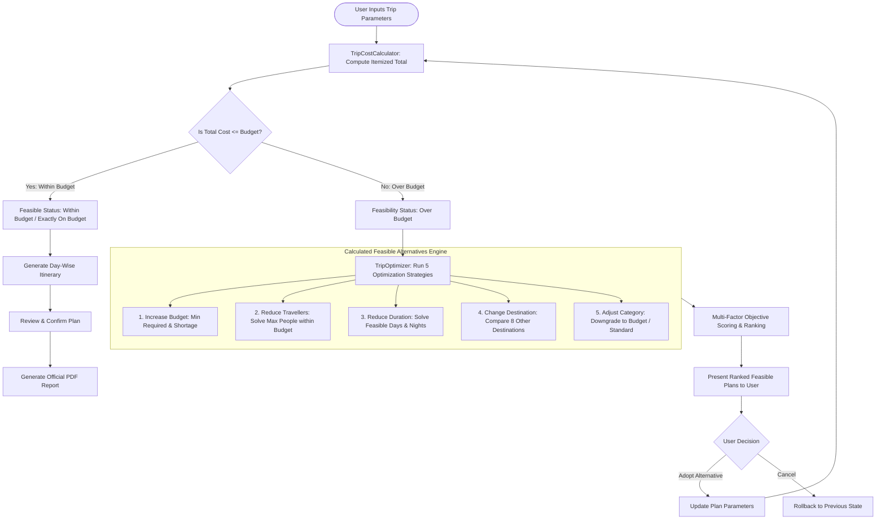

<p align="center">
  
</p>

<p align="center">
  <a href="./preview.html"><b>👉 Click Here to Open Interactive Dashboard (preview.html)</b></a>
</p>

<p align="center">
  
  
  
  
</p>

---

## Developer Profile
- **Author:** Muhammad Ali Ajaz
- **GitHub:** [@muhammadaliajaz](https://github.com/muhammadaliajaz)
- **Email:** [chaudharyaliajaz@gmail.com](mailto:chaudharyaliajaz@gmail.com)
- **Repository:** `python-smart-life-planner`

---

## 1. Project Overview

**Smart Life Planner** is a comprehensive Python application developed to tackle two core planning and financial challenges:

1. **Pakistan Trip Planner:** Plans domestic trips across 9 prominent destinations in Pakistan (Murree, Nathiagali, Swat, Kalam, Hunza, Skardu, Naran, Lahore, Islamabad). It calculates deterministic itemized costs, room requirements using ceiling division, duration (days and separate 0-night day trips), and emergency reserves. When an itinerary exceeds the available budget, an intelligent optimization engine computes 5 distinct feasible alternatives (increasing budget, reducing travellers, shortening duration, switching travel tiers, or recommending affordable alternative destinations) without hardcoding.
2. **Monthly Budget Manager:** Manages household (`Home & Kitchen`) and personal (`Personal Finance`) budgets, tracks planned allocations against actual expenditures, highlights category-specific and overall overspending, and calculates net savings and savings rates.

Both modules feature state rollback protection, atomic JSON persistence, 73 automated unit tests, and publication-quality PDF report generation using ReportLab.

---

## 2. Interactive HTML Web Preview

An interactive HTML dashboard is included directly in the root of the repository for live exploration and demonstration:

👉 **[Launch Interactive Dashboard (preview.html)](./preview.html)**

### How to Open:
1. Double-click `preview.html` in your file explorer, or open it in any web browser (Chrome, Edge, Firefox, Safari).
2. **Interactive Features Included:**
   - **Pakistan Trip Planner:** Test live costing by changing destination, budget, travellers, duration (days/nights), and tier. View live feasibility badges, day-wise itineraries, and real-time optimization alternatives when over budget.
   - **Monthly Budget Manager:** Adjust monthly income, switch budget types, add expenses in real time, view remaining balance, and see overspending alerts.
   - **PDF Report Specimen:** Visual representation of the ReportLab generated multi-page PDF layout with developer credentials in the footer.

---

## 3. System Architecture & Diagrams

### 3.1 High-Level Architecture Flowchart



---

### 3.2 OOP Class Diagram



---

### 3.3 Trip Optimization Decision Flowchart



---

## 4. Mathematical Calculations & Formulas

### Module One: Pakistan Trip Planner
$$\text{Transportation Cost} = \text{cost per person} \times \text{travellers}$$
$$\text{Required Rooms} = \left\lceil \frac{\text{travellers}}{\text{room capacity}} \right\rceil$$
$$\text{Accommodation Cost} = \begin{cases} 0 & \text{if } \text{nights} = 0 \\ \text{room rate} \times \text{required rooms} \times \text{nights} & \text{if } \text{nights} > 0 \end{cases}$$
$$\text{Food Cost} = \text{daily food cost per person} \times \text{travellers} \times \text{days}$$
$$\text{Activities \& Misc} = \text{activity rate per person} \times \text{travellers}$$
$$\text{Subtotal} = \text{Transportation} + \text{Accommodation} + \text{Food} + \text{Activities}$$
$$\text{Emergency Allowance} = \text{Subtotal} \times \left(\frac{\text{emergency percentage}}{100}\right)$$
$$\text{Total Trip Cost} = \text{Subtotal} + \text{Emergency Allowance}$$
$$\text{Cost Per Person} = \frac{\text{Total Trip Cost}}{\text{travellers}}$$

### Module Two: Monthly Budget Manager
$$\text{Total Planned} = \sum_{i=1}^{n} \text{Planned Amount}_i$$
$$\text{Total Actual} = \sum_{j=1}^{m} \text{Expense Amount}_j$$
$$\text{Remaining Balance} = \text{Total Available Income} - \text{Total Actual}$$
$$\text{Net Savings} = \max(0, \text{Remaining Balance})$$
$$\text{Savings Percentage} = \left(\frac{\text{Net Savings}}{\text{Total Available Income}}\right) \times 100$$
$$\text{Category Difference}_i = \text{Planned Amount}_i - \text{Actual Amount}_i$$
$$\text{Category Overspent if: } \text{Actual Amount}_i > \text{Planned Amount}_i$$

---

## 5. Python Standard Library Collections Usage

The project utilizes **four distinct data structures** from Python's standard `collections` module:

| Collection Structure | Project Implementation File | Purpose & Architectural Justification |
|---|---|---|
| `collections.namedtuple` | `models/trip.py`, `utils/validators.py`, `services/trip_optimizer.py` | Defines lightweight, immutable structured records for `CostBreakdown`, `OptimizationOption`, and `ValidationResult`. |
| `collections.Counter` | `models/budget.py` (`Budget.get_category_actual_totals`) | Aggregates recorded expenses into category-wise totals in $O(N)$ time with arithmetic grouping. |
| `collections.defaultdict` | `services/trip_planner.py` (`TripPlanner.destinations_by_type`) | Groups destination objects by regional category (`Mountains`, `Lakes & Nature`, `Historical Places`) without key initialization boilerplate. |
| `collections.deque` | `models/budget.py`, `services/trip_planner.py`, `utils/data_manager.py` | Implements bounded ring buffers (`maxlen=40`/`50`) tracking audit logs and state changes. |

---

## 6. Comprehensive Pytest Test Suite & Results

The test suite consists of **73 automated unit tests** covering normal execution, financial boundaries, input validation, corrupted file recovery, dynamic adjustments, and PDF generation.

### Execution Command
```bash
python -m pytest -v
```

### Detailed Test Matrix & Results

| Test Module | Test Method | Scenario & Boundary Condition Tested | Expected Outcome | Result |
|---|---|---|---|:---:|
| `test_trip_calculator.py` | `test_room_calculation` | Room ceiling division for 1, 2, 3, and 5 travellers with capacity 2 | Correct room counts (1, 1, 2, 3) | **PASSED** |
| `test_trip_calculator.py` | `test_zero_night_trip_has_zero_accommodation` | Single-day trip (1 Day / 0 Nights) | Accommodation cost is exactly PKR 0.00 | **PASSED** |
| `test_trip_calculator.py` | `test_cost_components_accuracy` | Complete multi-component breakdown for Hunza Standard trip | Accurate transport, food, lodging, emergency (10%), total | **PASSED** |
| `test_trip_calculator.py` | `test_budget_boundaries` | Exact budget, PKR 1 above budget, PKR 1 below budget | Correct feasibility: Exactly On Budget, Within, Over | **PASSED** |
| `test_trip_calculator.py` | `test_invalid_parameters_raise_value_error` | 0 travellers, 0 days, nights > days, negative budget | Raises `ValueError` safely | **PASSED** |
| `test_feasibility_checker.py` | `test_within_budget_evaluation` | Estimated cost < Available budget | `is_feasible = True`, surplus calculated | **PASSED** |
| `test_feasibility_checker.py` | `test_over_budget_evaluation` | Estimated cost > Available budget | `is_feasible = False`, shortage and % calculated | **PASSED** |
| `test_trip_optimizer.py` | `test_over_budget_generates_comprehensive_alternatives` | Trip exceeding budget by 70k PKR | Generates all 5 strategies; all options $\le$ budget | **PASSED** |
| `test_trip_optimizer.py` | `test_reduction_strategies_when_feasible` | Group of 4 exceeding budget | Solves max feasible travellers and shortened duration | **PASSED** |
| `test_trip_optimizer.py` | `test_extreme_budget_insufficient_for_any_destination` | Budget of only PKR 500 | Handles safely; never marks unaffordable plan as feasible | **PASSED** |
| `test_trip_planner.py` | `test_destination_filtering` | Filter by `Mountains`, `Lakes & Nature`, `Historical Places`, `Any` | Correct subsets returned | **PASSED** |
| `test_trip_planner.py` | `test_create_trip_plan` | Create standard trip plan | Initializes plan, breakdown, and day-wise itinerary | **PASSED** |
| `test_trip_planner.py` | `test_itinerary_day_trip` | 1 Day / 0 Night itinerary generation | Creates dedicated same-day round excursion itinerary | **PASSED** |
| `test_trip_planner.py` | `test_dynamic_modification_cancellation` | Modify travellers and cancel | Snapshot restores previous plan without corruption | **PASSED** |
| `test_trip_planner.py` | `test_dynamic_modification_confirmation` | Modify tier and confirm | Commits modifications and clears snapshot | **PASSED** |
| `test_trip_planner.py` | `test_confirm_and_save_plan` | Finalize and save plan | Persists confirmed trip record to `trips.json` | **PASSED** |
| `test_budget_manager.py` | `test_create_budget_valid` | Create monthly budget for Home & Kitchen | Initializes month, income, and default category keys | **PASSED** |
| `test_budget_manager.py` | `test_create_budget_invalid` | Empty month name or negative income | Raises `ValueError` safely | **PASSED** |
| `test_budget_manager.py` | `test_category_management` | Add custom category, duplicate check, update, remove | Correctly updates dictionary and rejects duplicates | **PASSED** |
| `test_budget_manager.py` | `test_record_update_delete_expense` | Record expense, update amount/description, delete expense | Correct ledger mutations and nonexistent ID handling | **PASSED** |
| `test_budget_manager.py` | `test_budget_calculations_and_overspending` | Spending exceeds allocation in one category | Flags overspent category; computes savings rate % | **PASSED** |
| `test_budget_manager.py` | `test_save_and_load_budget` | Save budget and reload via clean manager instance | Matches stored income, categories, and expense count | **PASSED** |
| `test_data_manager.py` | `test_directory_creation` | Startup with non-existent directories | Automatically provisions `data/`, `config/`, `reports/` | **PASSED** |
| `test_data_manager.py` | `test_developer_config_defaults` | Load missing developer profile | Falls back safely to default dictionary | **PASSED** |
| `test_data_manager.py` | `test_save_and_load_developer_config` | Write and read developer credentials | Accurately persists Name, GitHub username, and Email | **PASSED** |
| `test_data_manager.py` | `test_corrupted_json_handling` | File contains malformed/corrupted syntax | Recovers gracefully, returns empty default without crash | **PASSED** |
| `test_data_manager.py` | `test_empty_json_handling` | Zero-byte file | Handles safely and returns default list | **PASSED** |
| `test_data_manager.py` | `test_trips_persistence` | Append trip entry to JSON | Correctly appends and retrieves entries | **PASSED** |
| `test_data_manager.py` | `test_list_generated_reports` | Inspect reports directory | Returns list of `.pdf` report files | **PASSED** |
| `test_pdf_generator.py` | `test_unconfirmed_trip_rejects_pdf_generation` | Request PDF export on draft unconfirmed plan | Raises `ValueError` (enforces confirmation rule) | **PASSED** |
| `test_pdf_generator.py` | `test_confirmed_trip_generates_pdf` | Generate PDF for confirmed plan | Produces non-empty, multi-page valid PDF | **PASSED** |
| `test_pdf_generator.py` | `test_monthly_budget_generates_pdf` | Generate PDF for monthly budget | Produces multi-page financial report with ledger tables | **PASSED** |
| `test_pdf_generator.py` | `test_unique_pdf_filenames_prevent_overwriting` | Two consecutive PDF exports for same trip | Generates distinct timestamped filenames | **PASSED** |
| `test_validators.py` | `test_validate_positive_number_valid` [4 tests] | Numbers: 100, "2500.50", "0.05", 1 | Converts and validates valid positive floats | **PASSED** |
| `test_validators.py` | `test_validate_positive_number_invalid` [7 tests] | Values: 0, -10, "-50.0", "abc", None, "", " " | Safely rejects invalid numbers with clear error | **PASSED** |
| `test_validators.py` | `test_validate_integer_range_valid` [4 tests] | Ranges within bounds | Validates integers | **PASSED** |
| `test_validators.py` | `test_validate_integer_range_invalid` [6 tests] | Out-of-bounds, non-integers, floats with decimals | Correctly flags validation errors | **PASSED** |
| `test_validators.py` | `test_validate_trip_duration_valid` | Standard multi-day, 0-night day trip, equal days/nights | Validates duration tuples | **PASSED** |
| `test_validators.py` | `test_validate_trip_duration_invalid` | Nights > Days, negative nights, 0 days | Correctly flags invalid durations | **PASSED** |
| `test_validators.py` | `test_validate_travel_category_valid` [3 tests] | "budget", "Standard", "PREMIUM" | Normalizes to title-cased valid categories | **PASSED** |
| `test_validators.py` | `test_validate_travel_category_invalid` | "UltraLuxury" | Flags unsupported category | **PASSED** |
| `test_validators.py` | `test_validate_destination_type_valid` [5 tests] | Mountains, Historical Places, Lakes & Nature, Any | Normalizes valid types | **PASSED** |
| `test_validators.py` | `test_validate_destination_type_invalid` | "Beaches" | Flags invalid type | **PASSED** |
| `test_validators.py` | `test_validate_email` [6 tests] | Valid and invalid email patterns | Validates RFC email formats | **PASSED** |
| `test_validators.py` | `test_validate_non_empty_string` | Whitespace handling and empty string checks | Strips and validates strings | **PASSED** |

### Test Summary Output
```text
============================= test session starts =============================
platform win32 -- Python 3.14.5, pytest-9.2.0, pluggy-1.7.0
rootdir: C:\Users\aliaj\Documents\PSEB-Bootcamp\Curriculum\Week-01_Python-Basics\Python-Final-Project-Assessment
plugins: anyio-4.15.1
collected 73 items

tests/test_budget_manager.py ......                                      [  8%]
tests/test_data_manager.py .......                                       [ 17%]
tests/test_feasibility_checker.py ..                                     [ 20%]
tests/test_pdf_generator.py ....                                         [ 26%]
tests/test_trip_calculator.py .....                                      [ 32%]
tests/test_trip_optimizer.py ...                                         [ 36%]
tests/test_trip_planner.py ......                                        [ 45%]
tests/test_validators.py ........................................        [100%]

============================= 73 passed in 0.77s ==============================
```

---

## 7. Destination Catalog & Cost Assumptions

The catalog is stored in `data/destinations.json`. Costs reflect regional planning estimates:

| Destination | Region | Category | Room Cap | Base Transport | Base Room / Night | Food / Day | Activities / Person | Highlights |
|---|---|---|---|---|---|---|---|---|
| **Murree** | Punjab | Mountains | 2 | PKR 3,000 | PKR 4,500 | PKR 2,000 | PKR 2,500 | Mall Road, Patriata Cable Car, Pindi Point |
| **Nathiagali** | KP | Mountains | 2 | PKR 3,500 | PKR 5,000 | PKR 2,200 | PKR 2,500 | Mukshpuri Trek, Miranjani Peak, Pipeline Track |
| **Swat** | KP | Lakes & Nature | 2 | PKR 5,000 | PKR 4,500 | PKR 2,200 | PKR 3,000 | Malam Jabba, White Palace Marghazar |
| **Kalam** | KP | Lakes & Nature | 2 | PKR 6,500 | PKR 5,000 | PKR 2,400 | PKR 3,500 | Mahodand Lake Jeep Safari, Ushu Forest |
| **Hunza** | Gilgit-Baltistan | Mountains | 2 | PKR 12,000 | PKR 6,500 | PKR 2,800 | PKR 4,500 | Baltit Fort, Attabad Lake, Passu Cones |
| **Skardu** | Gilgit-Baltistan | Lakes & Nature | 2 | PKR 14,000 | PKR 7,000 | PKR 3,000 | PKR 5,000 | Shangrila Lake, Cold Desert, Deosai Plains |
| **Naran** | KP | Lakes & Nature | 2 | PKR 6,000 | PKR 5,000 | PKR 2,400 | PKR 3,500 | Lake Saiful Muluk, Babusar Top, Kunhar River |
| **Lahore** | Punjab | Historical Places | 2 | PKR 3,500 | PKR 4,000 | PKR 2,500 | PKR 2,000 | Badshahi Mosque, Lahore Fort, Walled City |
| **Islamabad** | Federal Capital | Historical Places | 2 | PKR 3,000 | PKR 4,500 | PKR 2,500 | PKR 2,200 | Faisal Mosque, Daman-e-Koh, Lok Virsa |

---

## 8. Installation & Execution Guide

### 8.1 Clone & Setup
```bash
git clone https://github.com/muhammadaliajaz/python-smart-life-planner.git
cd python-smart-life-planner
pip install -r requirements.txt
```

### 8.2 Run the Application
```bash
python main.py
```

### 8.3 Run Automated Tests
```bash
python -m pytest -v
```

---

## 9. Developer Configuration & PDF Reports

Developer metadata is stored in `config/developer.json`:
```json
{
  "developer_name": "Muhammad Ali Ajaz",
  "github_username": "muhammadaliajaz",
  "email": "chaudharyaliajaz@gmail.com"
}
```

This configuration is automatically loaded and displayed in:
1. The **Developer Information** menu option in `main.py`.
2. The bottom **footer line** on every page of generated PDF reports via `NumberedCanvas`:
   ```text
   Smart Life Planner | Developer: Muhammad Ali Ajaz | GitHub: @muhammadaliajaz | Email: chaudharyaliajaz@gmail.com | Page X of Y
   ```
